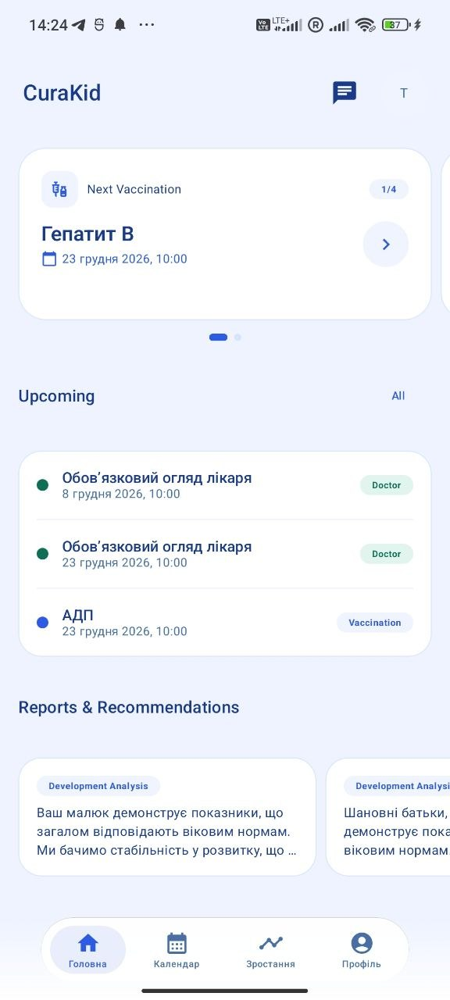
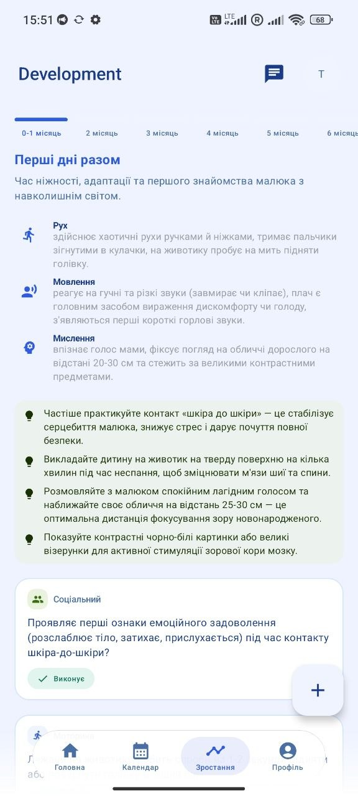
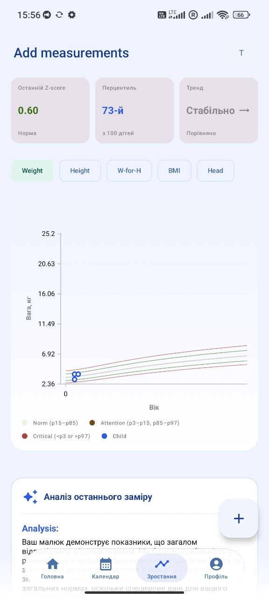
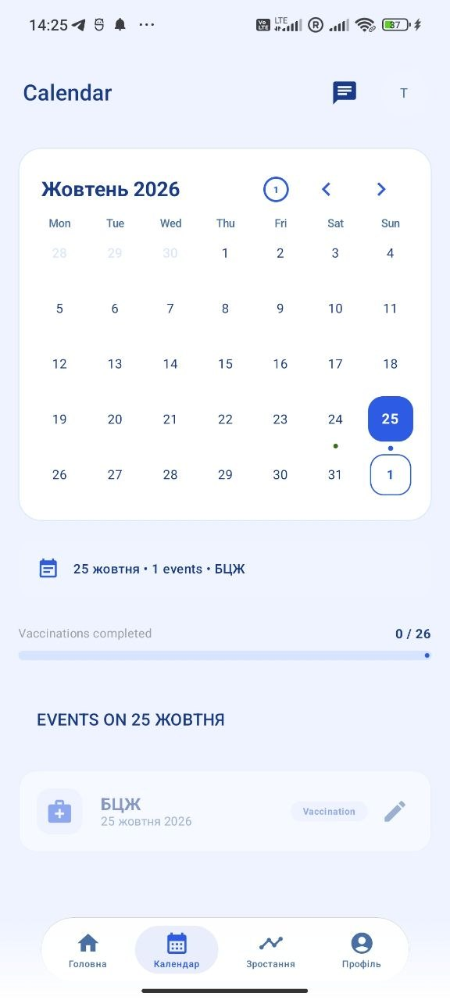
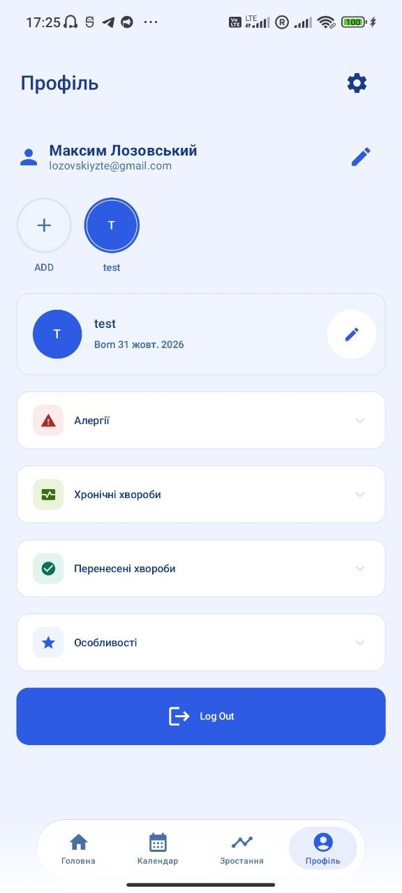

# CuraKid Android Application 📱

[](https://kotlinlang.org/)
[-3DDC84.svg?logo=android&logoColor=white)](https://developer.android.com/)
[](https://developer.android.com/jetpack/compose)
[](https://m3.material.io/)
[](https://dagger.dev/hilt/)
[](https://gradle.org/)

**CuraKid** is an advanced pediatric health companion and developmental milestone tracking application. It bridges the gap between daily parental care and evidence-based clinical protocols, offering personalized developmental assessments, WHO growth standard monitoring, scheduled medical/vaccination calendars, and seamless integration with the AI pediatric assistant backend.

---

## 📸 Application Showcase

<p align="center">
  
  
  
</p>

<p align="center">
  
  
</p>

### Key Screens Breakdown

| Screen | Description |
| :--- | :--- |
| **🏠 Home Dashboard** (`home.jpeg`) | Central overview displaying the child's age, rapid biometric indicators, upcoming medical appointments, vaccination alerts, and access to AI-generated health reports. |
| **📈 Development Tracking** (`development.jpeg`) | Periodic milestone roadmap categorized across cognitive, motor, linguistic, and socio-emotional domains according to clinical standards. |
| **📝 Milestone Logging** (`development_add.jpeg`) | Interactive modal to record emerging behaviors, notes, dates, and achievements to keep the child's developmental record up to date. |
| **📅 Smart Calendar** (`calendar.jpeg`) | Integrated timetable for pediatric checkups, national immunization schedules, medication reminders, and past health history. |
| **👶 Child Profile** (`profile.jpeg`) | Multi-child management, quick metric logs (height, weight, head circumference), personal health records, and family configuration. |

---

## ✨ Key Features

- **Evidence-Based Milestone Tracking**: Real-time evaluation of age-appropriate motor, cognitive, and social development milestones.
- **WHO Growth Curve Integration**: Tracks measurements against World Health Organization (WHO) growth percentile standards to identify potential health risks early.
- **AI-Powered Pediatric Support**: Instant queries and advice grounded by clinical documents via Gemini RAG (Retrieval-Augmented Generation).
- **Proactive Event & Immunization Calendar**: Pre-loaded vaccination guidelines and configurable visit notifications.
- **Modern Dark Theme UX**: Sleek, eye-friendly Material 3 interface custom-crafted for night-time parenting sessions.

---

## 🏗 Architecture & Engineering Patterns

The application is engineered adhering to **Clean Architecture** principles, **Modular Design**, and **Unidirectional Data Flow (UDF)** with **MVVM (Model-View-ViewModel)**:

```mermaid
graph TD
    UI["Jetpack Compose UI (Screens & Components)"] -->|User Action / Event| VM["ViewModel (@HiltViewModel)"]
    VM -->|Emits StateFlow<UiState>| UI
    VM -->|Executes| UC["Domain Layer (UseCases)"]
    UC -->|Interacts with| Repo["Data Layer (Repository Interfaces)"]
    Repo -->|Local Cache / DataStore| Local["Room DB / DataStore"]
    Repo -->|Remote API (HTTP / JSON)| Remote["Spring Boot Backend (/api/v1/*)"]
```

### Architectural Highlights:
1. **Unidirectional Data Flow (UDF)**:
   - Screens observe state via `@Immutable data class ...UiState` exposed through `StateFlow`.
   - UI emits events directly to `ViewModel` functions, ensuring deterministic state transitions.
2. **Modular Architecture**:
   - `:app`: Application entry point, dependency injection bindings, and root navigation graph.
   - `:core:domain`: Pure Kotlin business logic, models (`Child`, `Event`, `ChatMessage`), and domain Use Cases.
   - `:core:data`: Data repositories, networking clients, local storage, and mappers.
   - `:core:ui`: Common design system tokens, typography, shared Compose components, and dark theme definitions.
   - `:feature:*`: Encapsulated UI feature modules (`:feature:home`, `:feature:development`, `:feature:calendar`, `:feature:chat`, `:feature:profile`, `:feature:sign-up`).
3. **Dependency Injection**:
   - Powered by **Dagger Hilt** for clean lifecycle-aware component scoping.
4. **Asynchronous Programming**:
   - Structured concurrency with **Kotlin Coroutines** and reactive **Flow / StateFlow** pipelines.

---

## 🛠 Tech Stack

| Category | Technology |
| :--- | :--- |
| **Language** | [Kotlin 2.3.21](https://kotlinlang.org/) |
| **UI Framework** | [Jetpack Compose](https://developer.android.com/jetpack/compose) with Kotlin Compose Compiler |
| **Design System** | [Material 3](https://m3.material.io/) with custom dark surface elevation & palette tokens |
| **Architecture** | Clean Architecture + MVVM + Unidirectional Data Flow (UDF) |
| **Dependency Injection** | [Dagger Hilt](https://dagger.dev/hilt/) |
| **Async & Reactive** | Kotlin Coroutines, StateFlow, SharedFlow |
| **Networking & Serialization**| Retrofit, OkHttp, Kotlinx Serialization / Gson |
| **Rich Text Rendering** | Commonmark RichText for Markdown rendering in AI chat |
| **Code Coverage & Quality** | Jacoco (`jacocoRootReport`), JUnit 5, MockK |

---

## 📂 Project Structure

```text
front/
├── app/                  # Main application module, navigation graphs, Hilt Application
├── core/
│   ├── data/             # Repository implementations, network data sources, caching
│   ├── domain/           # Domain entities, Use Cases, repository contracts
│   └── ui/               # Reusable Compose components, Theme, Color, Type definitions
├── feature/
│   ├── calendar/         # Health events, vaccinations, calendar views
│   ├── chat/             # AI medical assistant chat UI (Markdown & streaming)
│   ├── development/      # Milestone roadmap, observation logger, child growth charts
│   ├── home/             # Main dashboard, summary cards, AI report viewer
│   ├── profile/          # Child profiles, family management, biometric lock
│   └── sign-up/          # Authentication, registration, password recovery flows
└── screenshots/          # High-resolution screenshots showcasing the app
```

---

## 🚀 Getting Started

### Prerequisites
- **Android Studio Ladybug (2024.2.1+)** or higher
- **JDK 17** or **JDK 21**
- Android SDK with `targetSdkVersion 35` and `minSdkVersion 26`

### Building the Project

1. **Clone the repository**:
   ```bash
   git clone <repository-url>
   cd front
   ```

2. **Build Debug APK**:
   ```bash
   ./gradlew assembleDebug
   ```

3. **Run Unit Tests & Jacoco Coverage Report**:
   ```bash
   ./gradlew testDebugUnitTest jacocoRootReport
   ```
   Reports will be generated in `app/build/reports/jacoco/jacocoRootReport/html/index.html`.

4. **Install on Device/Emulator**:
   ```bash
   ./gradlew installDebug
   ```

---

## 🛡 License

This project is developed as part of the academic diploma thesis and is protected under the terms of the project repository.
